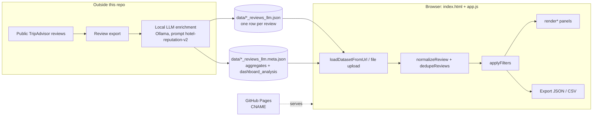

# Hotel Grano de Oro Reputation CRM

A static dashboard for hotel reputation management. It turns public guest reviews that an LLM has already enriched
into KPIs, diagnostics, and a CRM action queue.

## Description

The dashboard is a demo built on one property, Hotel Grano de Oro (San José, Costa Rica). It reads a JSON export of
public TripAdvisor reviews in which each review has extra `llm_*` fields: sentiment, topics, departments, root causes,
urgency, revenue impact, compliance risk, suggested owner, next CRM step, and a draft reply. A sibling `.meta.json` file
holds aggregate statistics and a written executive analysis.

It is meant for hotel managers, guest-relations staff, and marketing teams who want reviews organized as operational
work instead of a flat feed. The interface and the in-app documentation are in Spanish.

The site is plain HTML, CSS, and JavaScript, with no build step and no backend, and it is published with GitHub Pages.
The enrichment pipeline that produces the JSON (a local Ollama model, according to the metadata) is **not** in this
repo.

## Features

- **Six views in the sidebar:** KPIs and trend, AI diagnosis, strategy and benchmark, CRM and reviews, brand and
  risks, and documentation.
- **KPIs:** average rating, review volume, share of 4-5 star promoters, recovery cases, and LLM coverage, with
  month-over-month deltas.
- **Breakdowns:** topics, segments (trip type), rating distribution, root causes, departments, compliance risks,
  competitive signals, and the monthly timeline.
- **CRM action queue:** reviews ranked by urgency and revenue impact, each with an owner, SLA hours, a next step, and
  a draft reply.
- **LLM service analysis:** headline, executive summary, operational and revenue diagnosis, priorities, risk
  watchlist, and next steps, read from `dashboard_analysis` in the `.meta.json` file.
- **Filters:** property, source, segment, rating, urgency, and free-text search.
- **Data loading:** loads the bundled dataset by default, can load another JSON from a URL or from local files (more
  than one file at a time), and removes duplicate reviews.
- **Export:** downloads the filtered rows as JSON or CSV.
- **In-app documentation:** each panel links to a `#doc-*` section that explains its metric. `documentacion.html`
  redirects to that documentation panel.

## Architecture



## Requirements

- Any modern browser.
- To preview locally, any static file server (the example below uses Python 3).

## Installation and quick start

```bash
git clone https://github.com/Lapeyus/crm.git
cd crm
python3 -m http.server 8081 --bind 127.0.0.1
```

Open <http://127.0.0.1:8081/>. Opening `index.html` directly from disk does not work because `fetch()` cannot read
the JSON over `file://`.

## Usage

- **Default dataset:** `./data/hotel_grano_de_oro_reviews_llm.json` loads on startup. If a `.meta.json` file with the
  same base name exists, it loads too.
- **Another dataset:** enter a URL in the sidebar field and click *Cargar URL*, or choose one or more `.json` files.
  The file can be an array of reviews or an object whose values are arrays of reviews.
- **Deep links:** `#kpisPanel`, `#crmPanel`, `#documentationPanel`, `#doc-kpis`, and similar fragments open a
  specific view.
- **Export:** *Exportar JSON* and *Exportar CSV* download the rows that match the current filters.

### Expected review fields

The page normalizes field names (see `normalizeReview` in `app.js`). The bundled data uses `business_name`,
`review_id`, `source`, `rating`, `review_title`, `review_text`, `review_date`, `trip_type`, `review_url`,
`owner_response`, and `llm_*` fields such as `llm_sentiment`, `llm_topics`, `llm_departments`,
`llm_root_causes`, `llm_urgency`, `llm_sla_hours`, `llm_revenue_impact`, `llm_retention_risk`,
`llm_compliance_risks`, `llm_crm_next_step`, and `llm_response_draft`. When a row has no `llm_*` fields, the page
falls back to keyword heuristics, for example to infer root causes, owner, and urgency.

## Repository layout

```text
.
├── index.html            # Dashboard shell: sidebar, filters, panels, in-app docs (Spanish)
├── app.js                # Loading, normalization, filters, rendering, export
├── styles.css            # Layout and theme
├── documentacion.html    # Redirects to index.html#documentationPanel
├── data/
│   ├── hotel_grano_de_oro_reviews_llm.json       # Enriched review dataset
│   └── hotel_grano_de_oro_reviews_llm.meta.json  # Run metadata + aggregate LLM analysis
├── docs/
│   └── user-guide.md     # User guide (Spanish)
├── CNAME                 # Custom domain for GitHub Pages
└── .nojekyll             # Serve files as-is on GitHub Pages
```

## Configuration

There are no environment variables or secrets. The only setting is in code: `LLM_DATA_URL` at the top of `app.js`
picks the default dataset. `.gitignore` excludes `.DS_Store`, `node_modules/`, and `*.log`.

## Tests

There are no automated tests.

## Deployment

GitHub Pages serves the site from the default branch root (*Settings → Pages → Deploy from a branch → `/ (root)`*).
`CNAME` sets the custom domain, and `.nojekyll` turns off Jekyll processing. To update the published data, commit
new files under `data/`.

## Status and known limitations

- **Status:** demo. The commits are from 2026-06-03 and 2026-06-04.
- One property only: the title, labels, and default dataset are hard-coded to Hotel Grano de Oro.
- The enrichment script, prompts, and scraper are not included, so the dataset cannot be rebuilt from this repo.
- The LLM fields and the executive analysis are model output and have not been verified by a person. Read them as
  hypotheses.
- `docs/user-guide.md` still says 510 enriched reviews. The current metadata reports all 1,891.
- The bundled reviews are public posts, so they include reviewer display names and free text.

## License

The repo has no `LICENSE` file.
